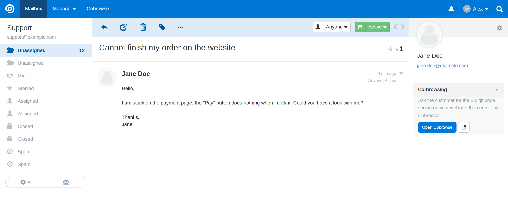
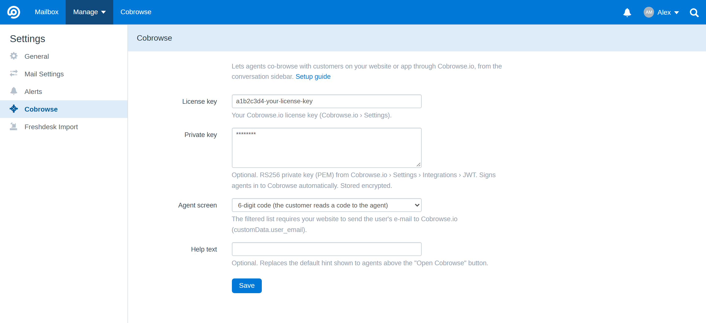

# Co-browsing for FreeScout — free and self-hosted, or Cobrowse.io

> Built as part of [Refresh](https://github.com/altmenorg/freescout-refresh), a new interface for FreeScout inspired by Freshdesk. Works with or without it.

**Free co-browsing for FreeScout.** See your customer's page live, from the ticket, and show them where to click — with
**no subscription and no third-party service**: a tiny relay on your own server, a script on your website, and this
module. Already paying for [Cobrowse.io](https://cobrowse.io)? The module works with it too.

| | **Self-hosted (free)** | **Cobrowse.io** |
|---|---|---|
| Cost | free, open source | Cobrowse.io subscription |
| Where the data goes | your server only, nothing is stored | Cobrowse.io |
| What the agent sees | the customer's page, live, pixel-exact (fonts, images, scroll, page changes) | the customer's screen |
| Pointing | a pointer while the agent holds the left button, a ripple on each click | Cobrowse.io tools |
| Remote control | no (view only) | yes, with Cobrowse.io |
| Mobile apps | websites only | websites and apps (SDKs) |
| Built on | [rrweb](https://github.com/rrweb-io/rrweb) (MIT) and a ~300-line Node.js relay | Cobrowse.io |

In both modes:

- **Sidebar block** in every conversation, collapsed by default. Nothing is loaded until the agent clicks
  **Open Cobrowse**.
- **Floating frame**, bottom right, with **Maximize** (remembered per browser), **Full screen** and **Close**.
- **6-digit code**: the customer clicks a link on your website, reads the code to the agent, accepts the session.
- **Full-page screen** at `/cobrowse`, linked from the top menu (and from the left bar of Refresh).
- English and French.





## Requirements

- FreeScout 1.8 or newer
- **Self-hosted:** Node.js 18 or newer on a server reachable by your customers (it can be the FreeScout or the website
  server), and a reverse proxy with WebSocket support (nginx, Apache…)
- **Cobrowse.io:** a Cobrowse.io account, and the Cobrowse.io SDK on your website or app

## Installation

1. Download [`Cobrowse.zip`](https://github.com/altmenorg/freescout-cobrowse/releases/latest/download/Cobrowse.zip) from the latest release and unzip it into the `Modules` folder of FreeScout: you get `Modules/Cobrowse`
   (the folder **must** be named `Cobrowse`).
2. In FreeScout, go to **Manage › Modules** and activate **Cobrowse**.
3. Go to **Manage › Settings › Cobrowse**, choose the **Provider**, and follow the matching section below.

**Updates:** from version 1.1.3, FreeScout tells you in **Manage › Modules** when a new version is out, and the **Update** button installs it in one click. From an older version, update once by hand as above.

## Self-hosted co-browsing (free)

```
customer's browser ──wss──▶ relay (Node.js, your server) ◀──wss── agent's browser (FreeScout)
   your website                 nothing stored                    /cobrowse/agent
   website/cobrowse.js          checks origins and tokens          replays the page (rrweb)
```

The customer's page is recorded with [rrweb](https://github.com/rrweb-io/rrweb) once the customer has accepted, sent to
the relay, and replayed live in the agent's browser. The agent's pointer goes the other way. The relay only passes
messages along; a session lives as long as the customer's page is open.

Everything you need is in the module: `relay/` (the relay) and `website/` (the script for your website, and the rrweb
recorder it loads).

### 1. Relay

On the server that will run it (paths below assume the module is in `/var/www/freescout/Modules/Cobrowse`; copy the
`relay` folder elsewhere if you prefer):

```bash
cd /var/www/freescout/Modules/Cobrowse/relay
npm ci --omit=dev
# shared secret, 32 characters or more, readable by the relay's user only
umask 077; openssl rand -base64 48 | tr -d '\n/+=' > /etc/cobrowse-secret
```

Run it as a service. With **systemd** (`/etc/systemd/system/cobrowse-relay.service`):

```ini
[Unit]
Description=FreeScout co-browsing relay
After=network.target

[Service]
User=www-data
WorkingDirectory=/var/www/freescout/Modules/Cobrowse/relay
ExecStart=/usr/bin/node relay.js
Environment=COBROWSE_PORT=8095
Environment=COBROWSE_SECRET_FILE=/etc/cobrowse-secret
Environment=COBROWSE_CLIENT_ORIGINS=https://www.example.com,https://example.com
Environment=COBROWSE_AGENT_ORIGINS=https://helpdesk.example.com
Restart=always

[Install]
WantedBy=multi-user.target
```

```bash
chown www-data /etc/cobrowse-secret
systemctl daemon-reload && systemctl enable --now cobrowse-relay
curl http://127.0.0.1:8095/cobrowse/health   # "ok 0"
```

With **supervisord**, the same as a `[program:cobrowse-relay]` with `command=/usr/bin/node relay.js`, the
`directory`, `user` and `environment=COBROWSE_PORT="8095",COBROWSE_SECRET_FILE="/etc/cobrowse-secret",…`.

| Variable | Meaning |
|---|---|
| `COBROWSE_PORT` | port on 127.0.0.1 (default 8095) |
| `COBROWSE_SECRET_FILE` | file holding the shared secret (default `~/.cobrowse-secret`) |
| `COBROWSE_CLIENT_ORIGINS` | your website(s), comma-separated: only these pages can start a session |
| `COBROWSE_AGENT_ORIGINS` | your FreeScout: only it can join a session (with a token signed by FreeScout) |

### 2. Reverse proxy

Publish the relay at `/cobrowse/ws` on a domain your customers already reach over HTTPS — typically your website's.
**nginx**, in the `server { … }` of that domain:

```nginx
location = /cobrowse/ws {
    proxy_pass http://127.0.0.1:8095;
    proxy_http_version 1.1;
    proxy_set_header Upgrade $http_upgrade;
    proxy_set_header Connection "upgrade";
    proxy_set_header Host $host;
    proxy_read_timeout 3600s;
    proxy_send_timeout 3600s;
    proxy_buffering off;
}
```

**Apache** (`mod_proxy_wstunnel`): `ProxyPass "/cobrowse/ws" "ws://127.0.0.1:8095/cobrowse/ws"`.

The relay address is then `wss://www.example.com/cobrowse/ws`.

### 3. Your website

Copy `website/cobrowse.js` and `website/rrweb-record-2.2.0.js` to your website (here in `/cobrowse/`), and add to
every page:

```html
<script defer src="/cobrowse/cobrowse.js"
        data-relay="wss://www.example.com/cobrowse/ws"
        data-record="/cobrowse/rrweb-record-2.2.0.js"
        data-lang="en"></script>

<!-- where you want it, e.g. in the footer -->
<a href="#" data-cobrowse-code>Get an assistance code</a> <span data-cobrowse-code-value></span>
```

The link shows a 6-digit code for 30 seconds; the customer reads it to the agent. When the agent types it, a dialog
asks the customer to accept; then a small "Assistance in progress · End" bar stays at the bottom of the page, from
page to page, until either side ends the session.

| Attribute | Meaning |
|---|---|
| `data-relay` | the relay address (required) |
| `data-record` | address of `rrweb-record-2.2.0.js` (loaded only when a session starts) |
| `data-lang` | `en` (default) or `fr` |
| `data-trigger`, `data-code` | selectors of the link and of the code, if you keep your own markup |
| `data-consent` | selector of your own consent dialog, if you prefer it to the built-in one: it gets the class `is-open` while asking; its `.cobrowse-consent__allow` button accepts, `.cobrowse-consent__deny`, `__close` and `__background` decline |
| `data-mask-inputs` | `all` to mask every field the customer types in; by default only passwords are masked, so the agent sees exactly what the customer sees |
| `data-color` | main color of the dialog, bar and pointer (hex, default `#d72d30`) |

If your website has a Content-Security-Policy, allow the relay in `connect-src` (`wss://www.example.com`).

### 4. CORS on your website's files — needed for a pixel-exact rendering

The agent's browser replays the page from your FreeScout's domain, and loads your website's fonts and images from
there. Browsers refuse **fonts** and **CSS masks** (`mask-image`) from another domain unless the response says it is
allowed: without it, the agent sees icon fonts as squares, your fonts replaced, masked shapes missing.

Send `Access-Control-Allow-Origin: *` on your website's static files. **nginx**, in the `location` that serves them:

```nginx
location ~* \.(?:css|js|woff2?|ttf|otf|eot|svg|png|jpe?g|webp|gif|ico)$ {
    add_header Access-Control-Allow-Origin "*" always;
    # … your existing directives (cache, try_files…)
}
```

**Apache:** `<FilesMatch "\.(css|js|woff2?|ttf|otf|eot|svg|png|jpe?g|webp|gif|ico)$"> Header set Access-Control-Allow-Origin "*" </FilesMatch>`.

Use `*`, not the requesting origin echoed back: browsers cache these files without regard to who asked first, and a
response cached for another origin (or for a plain ``) is then refused to FreeScout — fonts and masks come back
broken a few minutes later. A browser that opened the agent screen **before** you added the header keeps the refused
responses in its cache (up to their `max-age`): clear its cache once.

Fonts from Google Fonts already send this header.

### 5. FreeScout

**Manage › Settings › Cobrowse:** **Provider** = *Self-hosted relay*, **Relay URL** = `wss://www.example.com/cobrowse/ws`,
**Relay secret** = the content of the secret file (stored encrypted). Or in `.env`: `COBROWSE_PROVIDER=selfhosted`,
`COBROWSE_RELAY_URL=…`, `COBROWSE_RELAY_SECRET=…`.

The agent screen (`/cobrowse/agent`) works as soon as the relay is set, even before you switch the provider: handy to
try it while your team still uses Cobrowse.io.

### 6. Check

1. On your website, click the link: a code shows up (otherwise: relay, proxy or `COBROWSE_CLIENT_ORIGINS`).
2. In a ticket, **Co-browsing › Open Cobrowse**, type the code: the customer is asked to accept (otherwise "Unknown or
   expired code", or `COBROWSE_AGENT_ORIGINS` / the secret).
3. Accept: the page shows up. Compare it with the customer's: fonts and icons identical (otherwise: step 4).
4. Hold the left button over the page: the customer sees the pointer. Change page on the customer's side: the session
   follows.

### For the agent

- The session opens as soon as the six digits are typed.
- **Full screen** shows the page at the customer's size on a Full HD screen, with **Exit full screen** and
  **End session** at the bottom.
- Hold the left button down to show the pointer to the customer; each click draws a ripple. Nothing is clicked on the
  customer's page.

### Privacy and security

- Nothing is stored: the relay only passes messages between the two browsers of a session.
- The customer must accept each session; the bar at the bottom of the page lets them end it at any time.
- Only pages of `COBROWSE_CLIENT_ORIGINS` can open a session, only your FreeScout can join one, with a token signed
  by FreeScout (HMAC-SHA256, valid 8 hours).
- Passwords are never sent. Payment forms in an iframe of another domain (Stripe, PayPal…) are not recorded.
- Mention co-browsing in your privacy policy, as for any support tool.

## Cobrowse.io

**Provider** = *Cobrowse.io*.

| Setting | Where to find it |
|---|---|
| **License key** | Cobrowse.io › Settings. Required: without it the module stays hidden. |
| **Private key** (optional) | Cobrowse.io › Settings › Integrations › JWT: generate a key pair, paste the **private** key (PEM) here and keep the public key in Cobrowse.io. Enables automatic agent sign-in. Stored encrypted. |
| **Agent screen** | `6-digit code` (default), `Device list`, or `Device list filtered on the customer's e-mail`. |
| **Help text** (optional) | Replaces the hint shown to agents above the **Open Cobrowse** button, e.g. where the customer finds the code on your website. |

The same values can also be set in `.env` (`COBROWSE_LICENSE`, `COBROWSE_PRIVATE_KEY` = path to the PEM file,
`COBROWSE_EMBED`, `COBROWSE_HELP_TEXT`); the settings page takes precedence.

### On your website

Add the Cobrowse.io SDK to your website or app ([Cobrowse.io documentation](https://docs.cobrowse.io)).

- With the **6-digit code** screen, give customers a way to display a code, e.g. a "Co-browse with support" button that
  calls `CobrowseIO.createSessionCode()`.
- With the **filtered device list**, send the signed-in user's e-mail to Cobrowse.io as
  `CobrowseIO.customData = { user_email: '...' }`: the list is then filtered on the e-mail of the ticket's customer.

## How it works

- The sidebar block uses FreeScout's `conversation.after_customer_sidebar` hook; scripts and styles are loaded as files
  (FreeScout's Content-Security-Policy blocks inline scripts).
- Self-hosted: the agent token is `base64url(JSON {n, exp}).base64url(HMAC-SHA256)`, signed with the relay secret; the
  agent screen replays the page with rrweb's `Replayer` in live mode, scaled to the frame.
- Cobrowse.io: the agent JWT is signed server-side with `openssl_sign` (RS256), valid for 8 hours, with the claims
  required by Cobrowse.io (`iss` = license key, `sub` = agent e-mail, `displayName`, `aud`). No external dependency.

## Other modules from the Refresh project

This module was built as part of [Refresh](https://github.com/altmenorg/freescout-refresh), a new interface for FreeScout. The modules of the project, all usable on their own:

- **[Refresh](https://github.com/altmenorg/freescout-refresh)**: a new, Freshdesk-inspired interface for FreeScout: views, SLA badges, dashboard, properties panel, phone version.
- **[Web Push](https://github.com/altmenorg/freescout-webpush)**: install FreeScout as an app on phones and desktops, with end-to-end encrypted Web Push notifications.
- **[Freshdesk Import](https://github.com/altmenorg/freescout-freshdesk-import)**: import your Freshdesk tickets into FreeScout and keep them in sync until you switch over.
- **[Claude Assistant](https://github.com/altmenorg/freescout-claude-assistant)**: draft and improve replies with Claude, from the reply editor.

## License

[AGPL-3.0](LICENSE), like FreeScout.

The self-hosted mode bundles [rrweb](https://github.com/rrweb-io/rrweb) 2.2.0 (MIT): `website/rrweb-record-2.2.0.js` and
`Public/vendor/rrweb-2.2.0/`.

Cobrowse.io is a trademark of its owner. This module is an independent integration, not affiliated with or endorsed
by Cobrowse.io.
